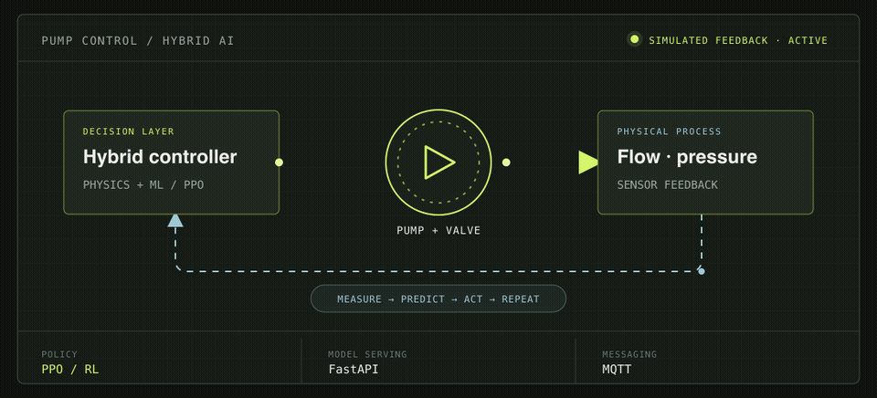
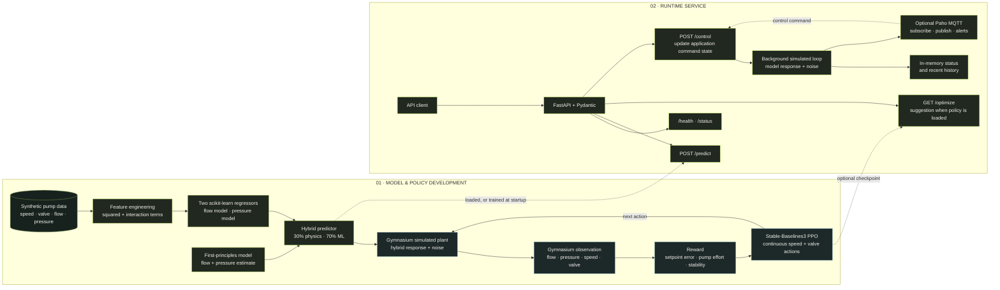
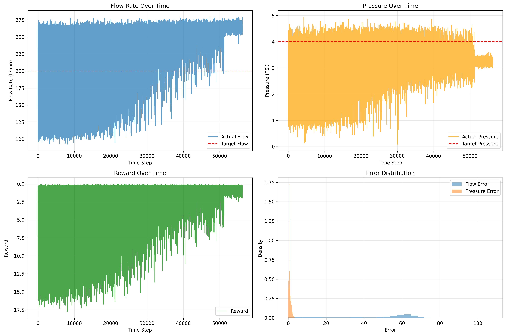
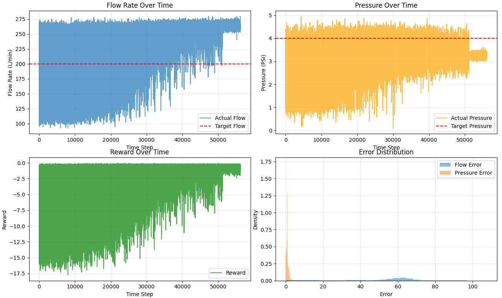
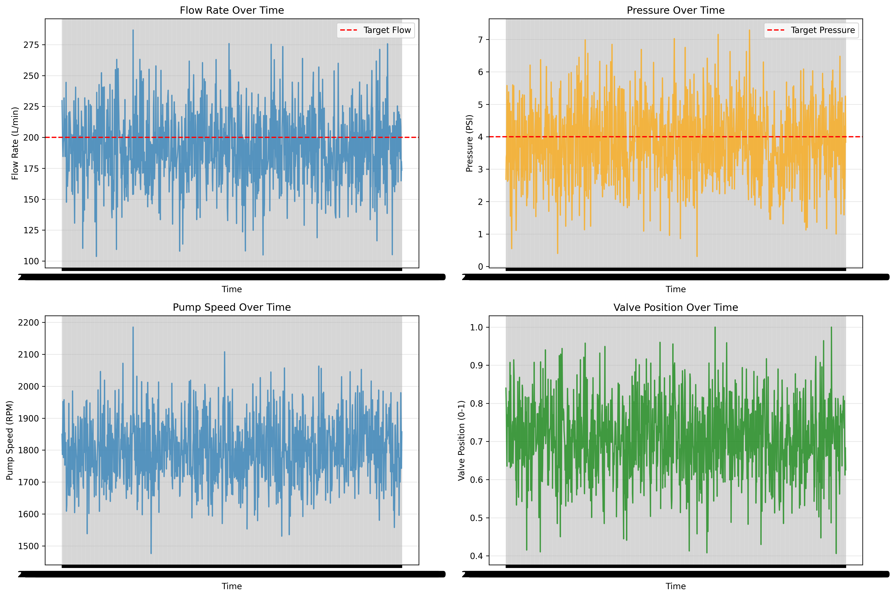
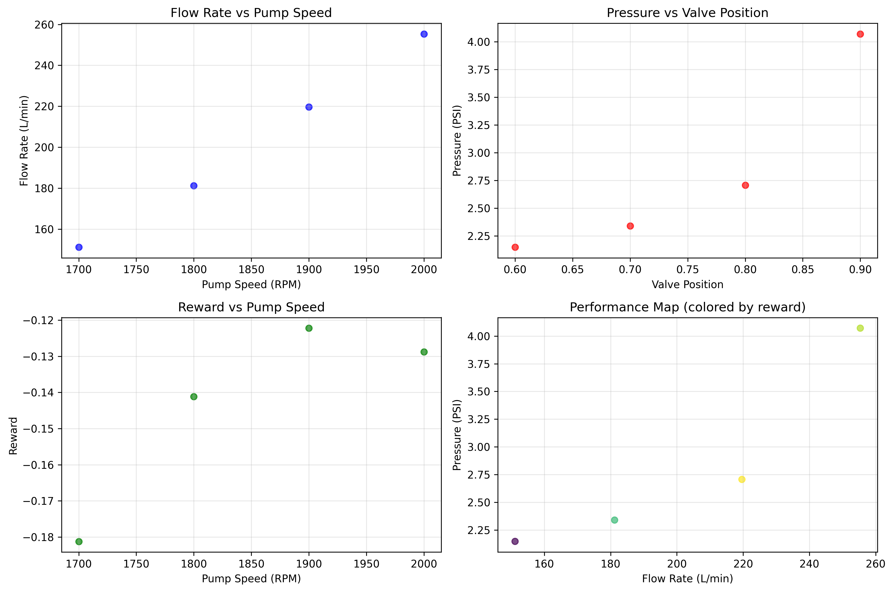

<div align="center">
  
  <h1>AI-Driven Pump Control</h1>
  <p><strong>From fluid-dynamics model to reinforcement-learning policy to edge API.</strong></p>
  <p>
    I built an end-to-end, simulation-first control prototype that combines a first-principles pump model,
    data-driven flow and pressure prediction, PPO policy training, and a FastAPI/MQTT service.
  </p>
  <p>
    <a href="https://github.com/abh2050/reinforcement_learning_based_pump_control_with_edge_deployment/actions"></a>
    
    
    
    
    
  </p>
  <p>
    <a href="https://abh2050.github.io/reinforcement_learning_based_pump_control_with_edge_deployment/">Project page</a> ·
    <a href="#system-flow">System flow</a> ·
    <a href="#reported-results">Results</a> ·
    <a href="#run-it">Run it</a>
  </p>
</div>

## Project snapshot

| | |
|---|---|
| **Problem** | Explore how pump speed and valve position can be selected to track flow and pressure targets while accounting for energy use and control stability. |
| **Approach** | Combine a simplified fluid model with learned predictors, then train a continuous-action PPO policy inside a Gymnasium environment. |
| **Built** | Physics + ML model, custom RL environment and reward, training/evaluation workflow, FastAPI interface, MQTT messaging, Docker packaging, and CI smoke checks. |
| **Evaluation context** | Synthetic pump data and a simulated plant response. This is a research/demo prototype—not a field deployment or safety-certified controller. |

## What I built

### 1. A hybrid model of the pump process

In [`hybrid_control_model.py`](hybrid_control_model.py), I implemented three cooperating pieces:

- **A first-principles baseline.** `FluidDynamicsModel` estimates flow from normalized pump speed and valve opening, and estimates pressure with a simplified velocity/valve-resistance calculation.
- **Two learned predictors.** `MLControlModel` trains separate scikit-learn `GradientBoostingRegressor` models for flow and pressure. It engineers squared, interaction, and normalized-speed features, scales the inputs and targets, and reports held-out MSE and R².
- **A configurable hybrid.** `HybridControlModel` blends the two predictions (default: **30% physics / 70% ML**). If the learned model has not been trained, prediction falls back to the physics model.

The split is deliberate: the physics model gives the controller a structured baseline; the learned component can adapt predictions to the available data. Neither should be mistaken for a validated digital twin.

### 2. A continuous-control RL environment

In [`rl_agent.py`](rl_agent.py), I created a Gymnasium environment that lets PPO interact with the hybrid plant model:

| Environment element | Implementation |
|---|---|
| **Observation** | Four values: normalized flow, pressure, pump speed, and valve position |
| **Action** | Two continuous values in `[-1, 1]`, mapped to **1,500–2,200 RPM** and **0.4–1.0 valve position** |
| **Process response** | Hybrid-model flow and pressure, with configurable noise and physical output clipping |
| **Reward** | Penalizes normalized flow and pressure setpoint error, pump-speed effort as an energy proxy, and step-to-step changes in flow/pressure |
| **Episode** | 1,000 environment steps by default; shortened to 10 steps for the CI environment smoke check |

The PPO implementation uses Stable-Baselines3 with an MLP policy. Its configured starting parameters are a `3e-4` learning rate, `2,048` steps per rollout, batch size `64`, `10` epochs per update, `gamma=0.99`, `gae_lambda=0.95`, and `clip_range=0.2`. The agent can evaluate episodes, report flow/pressure error statistics, save/load a policy, and produce training plots.

The reward implemented in `RewardFunction` is:

```text
r = -0.6 × (flow_error / target_flow)²
    -0.4 × (pressure_error / target_pressure)²
    -0.1 × (pump_speed / 2200)²
    -0.1 × (|Δflow| + |Δpressure|)   # only after a previous step exists
```

The last term penalizes changes in process output; the pump-speed term is a **proxy** for effort, not a measured energy model.

### 3. An API and messaging surface for edge experiments

In [`edge_deployment.py`](edge_deployment.py), I built a FastAPI service with Pydantic request/response models, lifecycle hooks, a background simulated system loop, bounded in-memory history, health checks, and optional Paho MQTT integration.

- If a saved hybrid-model artifact is present, startup loads it; otherwise, startup trains the ML component from the repository's synthetic CSV.
- When the service is started, the background loop simulates sensor readings from the model, updates in-memory status/history, and publishes sensor and status messages when MQTT is connected.
- MQTT subscribes to the control-command topic and publishes sensor data, status, predictions, and alerts.
- `/optimize` returns an RL action suggestion **only when a compatible trained PPO checkpoint is available**.

This is an integration surface for a prototype. The API does not connect to pump hardware, and an optimization suggestion is not automatically applied to a physical actuator.

### 4. Packaging and repeatable checks

- **Docker:** a multi-stage Python 3.10 image installs dependencies in a builder stage, runs as a non-root user, exposes port `8000`, and defines a `/health` container check.
- **Docker Compose:** declares the API, Mosquitto, Redis, InfluxDB, and Grafana services for local infrastructure experiments.
- **GitHub Actions:** runs the repository smoke script on Python 3.8, 3.9, and 3.10; CI installs CPU-only PyTorch to avoid pulling CUDA packages into hosted runners.
- **Visual diagnostics:** the existing training, system, and demo plots are included below.

## System flow

The diagram distinguishes **offline training** from the **runtime prototype**. Training the policy and serving an API are separate paths; only the prediction model is trained automatically by API startup. The saved PPO policy is an optional artifact.



### A control decision, step by step

1. The environment observes process output and current actuator settings.
2. PPO chooses normalized pump-speed and valve actions; the environment maps them into operating bounds.
3. The hybrid model predicts the next flow and pressure response; simulation noise is applied and outputs are clipped.
4. The reward scores target tracking, pump effort, and—after the first transition—changes in process output.
5. PPO uses the transition to update its policy during training; the loop repeats.

## Reported results

| Workstream | Reported result | How to interpret it |
|---|---:|---|
| **Flow prediction** | R² **0.9655** | Held-out score reported by the project; the data is synthetic. |
| **Pressure prediction** | R² **0.1188** | Weak predictive fit; this is a material limitation, not a result to hide behind the hybrid label. |
| **PPO training** | **51,200** steps · **790 FPS** | The training entry point requests 50,000 steps; PPO collects complete 2,048-step rollouts, yielding the reported 51,200 total. |
| **Pressure-control evaluation** | **0.75 ± 0.08 PSI** mean absolute error | Reported over five simulated evaluation episodes against a 4 PSI setpoint. |
| **Flow-control evaluation** | **63.97 ± 4.02 L/min** mean absolute error | Reported over five simulated evaluation episodes against a 200 L/min setpoint; flow tracking needs more work. |

These are repository-reported simulation results, not independently reproduced benchmarks or measurements from physical equipment. The source of truth and further PPO diagnostics are in [`TRAINING_RESULTS.md`](TRAINING_RESULTS.md); the project notes are in [`PROJECT_SUMMARY.md`](PROJECT_SUMMARY.md).

### Existing project visualizations

<table>
  <tr>
    <td width="50%"><br><sub>PPO training and evaluation</sub></td>
    <td width="50%"><br><sub>Training diagnostics</sub></td>
  </tr>
  <tr>
    <td width="50%"><br><sub>Synthetic system traces</sub></td>
    <td width="50%"><br><sub>Demo predictions and operating points</sub></td>
  </tr>
</table>

## Technology stack

| Area | Technologies | How they are used here |
|---|---|---|
| **Language & data** | Python 3.8–3.10, NumPy, pandas | Control models, tabular pump data, arrays, and the RL environment |
| **Classical ML** | scikit-learn | `GradientBoostingRegressor`, 80/20 train/test split, `StandardScaler`, and MSE/R² evaluation |
| **Reinforcement learning** | Gymnasium, Stable-Baselines3 PPO, PyTorch | Custom continuous-action environment and policy training/inference |
| **API & validation** | FastAPI, Pydantic, Uvicorn, HTTPX | Typed request validation, REST endpoints, serving, and API smoke checks |
| **Industrial messaging** | Paho MQTT, Eclipse Mosquitto | Topic-based commands, simulated sensor data, status, predictions, and alerts |
| **Visualization** | Matplotlib, Seaborn, Plotly | Plot dependencies; training and project plots are Matplotlib |
| **Web project page** | HTML, CSS, inline SVG, GitHub Pages | Responsive project overview at [`docs/index.html`](docs/index.html) |
| **Packaging & automation** | Docker, Docker Compose, GitHub Actions | Multi-stage image, declared local service stack, and three-version Python CI matrix |

**Implementation detail:** XGBoost is pinned and import-checked by the current dependency/CI setup, but the predictor implemented in `hybrid_control_model.py` is scikit-learn's `GradientBoostingRegressor`. Redis, InfluxDB, and Grafana appear in the Compose configuration; the Python app currently does not persist to Redis/InfluxDB or publish Grafana metrics.

## Run it

### 1. Install and start the API

The repository includes `Synthetic_Pump_System_Data.csv`. On first startup, if a saved hybrid model is absent, the service trains its ML component from this file.

```bash
git clone https://github.com/abh2050/reinforcement_learning_based_pump_control_with_edge_deployment.git
cd reinforcement_learning_based_pump_control_with_edge_deployment

python3 -m venv .venv
source .venv/bin/activate          # Windows: .venv\Scripts\activate
python -m pip install --upgrade pip
python -m pip install -r requirements.txt

python edge_deployment.py
```

The service listens at `http://localhost:8000`. Open the interactive API docs at [`/docs`](http://localhost:8000/docs), or check [`/health`](http://localhost:8000/health).

### 2. Try a prediction

```bash
curl -X POST http://localhost:8000/predict \
  -H "Content-Type: application/json" \
  -d '{"pump_speed_rpm": 1800, "valve_position": 0.7}'
```

### 3. Train and evaluate PPO (optional)

This command trains the hybrid ML component, trains PPO, evaluates five episodes, saves `ppo_pump_control.zip`, and writes `rl_performance.png`. Training can take longer than the API smoke check.

```bash
python rl_agent.py
```

The PPO checkpoint is not committed to the repository. The API's `/optimize` route needs the trained checkpoint in its working directory to return an action suggestion.

### 4. Run the CI smoke script

```bash
python test_ci.py
```

GitHub Actions runs this script on Python 3.8, 3.9, and 3.10 and installs CPU-only PyTorch first on Linux runners to avoid large CUDA downloads.

**Validation caveat:** `test_ci.py` currently prints component failures but exits with status `0` even when checks fail. The workflow invokes that script twice per matrix job. A green badge therefore confirms the workflow completed, but it is not yet a strict pass/fail test gate.

## API reference

| Method | Route | Behavior |
|---|---|---|
| `GET` | `/health` | Health response and whether the hybrid model, reward function, and RL agent are loaded |
| `GET` | `/status` | Current in-memory run state, process values, commands, mode, and health |
| `POST` | `/predict` | Hybrid prediction for `pump_speed_rpm` and `valve_position`; also returns reward and a placeholder confidence field |
| `GET` | `/optimize` | Deterministic action suggestion from a loaded PPO policy and current service state |
| `POST` | `/control` | Update the app's pump-speed, valve-position, and control-mode state |
| `POST` | `/start` · `POST /stop` | Toggle the simulated background system loop |
| `GET` | `/history?limit=100` | Read recent process records from bounded in-memory history |
| `GET` | `/mqtt/topics` | Return configured topics and broker connection information |

### MQTT topic map

| Topic | Direction in the service | Purpose |
|---|---|---|
| `pump_system/control` | Subscribe | Receive and validate a control command |
| `pump_system/sensors` | Publish | Publish simulated pump, valve, flow, and pressure values |
| `pump_system/status` | Publish | Publish run state and system-health information |
| `pump_system/predictions` | Publish | Publish prediction results when requested |
| `pump_system/alerts` | Publish | Publish simulated health alerts |

## Engineering boundaries and next steps

Being clear about the prototype boundary is part of the engineering story:

- **Synthetic plant, not hardware.** The environment and service loop simulate process response. There is no physical I/O driver, PLC integration, hardware-in-the-loop test, or safety certification.
- **Pressure prediction needs work.** The reported pressure R² is 0.1188. A future iteration should improve data quality and model validation before relying on learned pressure estimates.
- **RL interface needs a contract check.** The environment returns normalized observations, while its declared Gymnasium observation-space bounds are expressed in the original physical units. Aligning the space with the returned values and adding a Gymnasium environment checker are important next steps.
- **Training and inference artifacts are separate.** A PPO checkpoint is generated by `python rl_agent.py` and is not included in the repository; the API does not train PPO automatically.
- **The service is prototype-scale.** System history is in memory and capped at 1,000 records. Redis and InfluxDB are declared in Compose but are not used by the Python service.
- **Compose needs environment review.** MQTT defaults to `localhost` in the application, which does not resolve to the broker service from inside the API container; configure the broker host before expecting container-to-container MQTT. The current service constructor does not read the broker-host environment variables declared in `config.py`.
- **Prediction confidence is not calibrated.** `POST /predict` currently returns a placeholder `model_confidence` value, not a confidence estimate validated against model errors.
- **The predictor is not yet a production model.** Validate generalization on measured pump data, add disturbance/domain-shift evaluation, and benchmark policy behavior against a conventional control baseline before considering a real deployment.

## Repository map

| File | Responsibility |
|---|---|
| [`hybrid_control_model.py`](hybrid_control_model.py) | Fluid model, learned predictors, hybrid blend, and reward function |
| [`rl_agent.py`](rl_agent.py) | Gymnasium environment, PPO training/evaluation, model persistence, and plots |
| [`edge_deployment.py`](edge_deployment.py) | FastAPI lifecycle/endpoints, simulated monitor, in-memory state, and MQTT |
| [`config.py`](config.py) | System limits, target values, reward weights, and MQTT topic definitions |
| [`Synthetic_Pump_System_Data.csv`](Synthetic_Pump_System_Data.csv) | Synthetic flow/pressure training data |
| [`test_ci.py`](test_ci.py) · [`test_system.py`](test_system.py) | CI smoke script and component/system checks |
| [`Dockerfile`](Dockerfile) · [`docker-compose.yml`](docker-compose.yml) | Container image and local multi-service declaration |
| [`docs/index.html`](docs/index.html) | Project landing page |
| [`TRAINING_RESULTS.md`](TRAINING_RESULTS.md) · [`PROJECT_SUMMARY.md`](PROJECT_SUMMARY.md) | Reported training metrics and project notes |

## More

- [Project landing page](https://abh2050.github.io/reinforcement_learning_based_pump_control_with_edge_deployment/)
- [Training results and metric interpretation](TRAINING_RESULTS.md)
- [Project summary](PROJECT_SUMMARY.md)
- [FastAPI OpenAPI docs](http://localhost:8000/docs) (available after starting the service)

<div align="center">
  <sub>Built by <a href="https://github.com/abh2050">Abhishek Shah</a> · AI for control, simulation, and edge-system engineering</sub>
</div>
