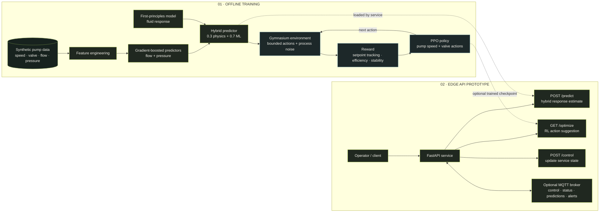

<div align="center">
  
  <h1>AI-Driven Pump Control</h1>
  <p><strong>Fluid dynamics × machine learning × reinforcement learning × edge APIs</strong></p>
  <p>
    <a href="https://github.com/abh2050/reinforcement_learning_based_pump_control_with_edge_deployment/actions"></a>
    
    
    
    
  </p>
</div>

> **A simulation-first control systems project.** A first-principles pump model and a learned predictor feed a PPO policy; a FastAPI service exposes predictions, status, and control interfaces for edge-oriented experiments.

[Project page](https://abh2050.github.io/reinforcement_learning_based_pump_control_with_edge_deployment/) · [API docs](#api) · [Results](#reported-results) · [Training notes](TRAINING_RESULTS.md)

## The process, end to end

The diagram separates **offline model and policy training** from the **runtime API prototype**. The process model is simulated; the API does not directly operate or safety-certify physical pump hardware.



### What happens in the loop

1. **Model the plant.** `FluidDynamicsModel` estimates flow and pressure from pump speed and valve position.
2. **Learn the response.** `MLControlModel` trains two gradient-boosted regressors on pump data, with engineered input features.
3. **Blend predictions.** `HybridControlModel` combines the physics and ML outputs (default weights: 0.3 and 0.7). If the ML model is not trained, it falls back to physics.
4. **Train a policy.** A Gymnasium environment applies bounded pump/valve actions to the model, adds configurable noise, and scores target tracking, pump effort, and stability. PPO learns a policy from these transitions.
5. **Expose the prototype.** FastAPI serves status, prediction, optimization, and control routes; MQTT support provides a messaging interface.

## Reported results

| Experiment | Repository-reported result |
|---|---:|
| Flow prediction | R² = **0.9655** |
| Pressure prediction | R² = **0.1188** |
| PPO training | **51,200** timesteps; **790 FPS** reported |
| Pressure control evaluation | **0.75 ± 0.08 PSI** error; 81% reported accuracy against a 4 PSI target |
| Flow control evaluation | **63.97 ± 4.02 L/min** error; 68% reported accuracy against a 200 L/min target |

These are results reported by this repository's synthetic/demo workflows, not field measurements. The low pressure-prediction R² is an important limitation; the control figures are not a guarantee of real-world performance. See [training results](TRAINING_RESULTS.md) and the [project summary](PROJECT_SUMMARY.md) for additional context.

### Visual results

<table>
  <tr>
    <td width="50%"><br><sub>PPO training performance</sub></td>
    <td width="50%"><br><sub>Synthetic system traces</sub></td>
  </tr>
  <tr>
    <td width="50%"><br><sub>Training diagnostics</sub></td>
    <td width="50%"><br><sub>Demo predictions and operating points</sub></td>
  </tr>
</table>

## Get started

The repository includes `Synthetic_Pump_System_Data.csv`. On startup, the API loads a saved hybrid-model artifact if present; otherwise, it trains the ML component from that CSV. A trained PPO checkpoint is **not included** in the repository, so `/optimize` needs a compatible checkpoint to be available.

```bash
git clone https://github.com/abh2050/reinforcement_learning_based_pump_control_with_edge_deployment.git
cd reinforcement_learning_based_pump_control_with_edge_deployment

python3 -m venv .venv
source .venv/bin/activate          # Windows: .venv\Scripts\activate
python -m pip install --upgrade pip
python -m pip install -r requirements.txt

python edge_deployment.py
```

The API starts at `http://localhost:8000`. Interactive OpenAPI docs are at [`/docs`](http://localhost:8000/docs); the health endpoint is [`/health`](http://localhost:8000/health).

For CI smoke checks, use the same script as the GitHub Actions workflow:

```bash
python test_ci.py
```

The workflow runs this on Python 3.8, 3.9, and 3.10. On Linux CI, it installs CPU-only PyTorch first to avoid downloading CUDA libraries; local PyTorch installation options are documented by [PyTorch](https://pytorch.org/get-started/locally/).

## API

| Method | Route | Purpose |
|---|---|---|
| `GET` | `/health` | Service health and model-load status |
| `GET` | `/status` | Current in-memory system status |
| `POST` | `/predict` | Predict flow, pressure, and reward for pump/valve inputs |
| `GET` | `/optimize` | Request an action suggestion from a loaded RL agent |
| `POST` | `/control` | Update the service's pump/valve command state |
| `POST` | `/start` · `/stop` | Start or stop the simulated service loop |
| `GET` | `/history` | Read recent in-memory history |
| `GET` | `/mqtt/topics` | Inspect MQTT topics and connection status |

Example prediction:

```bash
curl -X POST http://localhost:8000/predict \
  -H "Content-Type: application/json" \
  -d '{"pump_speed_rpm": 1800, "valve_position": 0.7}'
```

MQTT topics are defined in [`config.py`](config.py): `pump_system/sensors`, `pump_system/control`, `pump_system/status`, `pump_system/predictions`, and `pump_system/alerts`. MQTT support is optional when the client or broker is unavailable.

> **Hardware and safety:** `/control` updates application state; this repository does not include a physical pump driver, hardware-in-the-loop validation, or safety certification. Treat all outputs as prototype suggestions and validate independently before any real equipment integration.

## Repository map

| Path | Description |
|---|---|
| [`hybrid_control_model.py`](hybrid_control_model.py) | Physics model, gradient-boosted predictors, hybrid blend, and reward function |
| [`rl_agent.py`](rl_agent.py) | Gymnasium environment and Stable-Baselines3 PPO agent |
| [`edge_deployment.py`](edge_deployment.py) | FastAPI service, MQTT interface, and in-memory system state |
| [`config.py`](config.py) | Setpoints, operating limits, reward weights, and MQTT topics |
| [`Synthetic_Pump_System_Data.csv`](Synthetic_Pump_System_Data.csv) | Synthetic demonstration/training data |
| [`docs/index.html`](docs/index.html) | Project overview page |
| [`PROJECT_SUMMARY.md`](PROJECT_SUMMARY.md) · [`TRAINING_RESULTS.md`](TRAINING_RESULTS.md) | Project notes and reported evaluation |
| [`.github/workflows/ci-cd.yml`](.github/workflows/ci-cd.yml) | Python CI matrix and deployment-package workflow |

## Technology

**Python** · NumPy · pandas · scikit-learn · XGBoost · Gymnasium · Stable-Baselines3/PPO · FastAPI · Paho MQTT · Docker Compose

---

<div align="center">
  <sub>Built by <a href="https://github.com/abh2050">Abhishek Shah</a> · Simulation-first controls research and edge-deployment prototype</sub>
</div>
